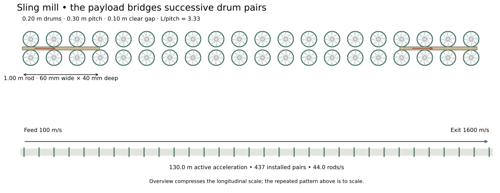

# Historical study overview

Use the [current publication packet](../README.md) for the selected model and assets. This overview preserves the earlier development narrative.

# Sling mill

**[Current optimized iron reference](../../blended/IRON_REFERENCE.md)** targets 1,600 m/s with iron payload properties, tensile bar loading and the expanded hardware budget. Its mass inventory supplies the publication pie chart.

**[Payload material and updated machine payoff](../../publication/PAYLOAD_AND_PAYOFF.md)** records the iron selection, corrects the assumed end-compression constraint, and gives the fixed-geometry hardware audit and cross-design comparison. Earlier search numbers below retain their original assumptions.

A straight mechanical mass driver accelerates manufactured rods through successive pairs of opposed, deliberately slipping flexible-belt drums. This study asks whether **one lane can deliver 10 million tonnes per year at 1,600 m/s**, and how payload strength, rotor construction, contact heating and drive architecture set its dimensions and material requirements.

The first executable model closes the flow, discrete engagement and sliding-energy budgets. The 1,000-g example uses 1 m × 60 mm × 40 mm rods, 200 mm diameter drums and approximately 130 m of active accelerator. Its flexible contact geometry remains the main feasibility question.



The illustration uses **300 mm station pitch and 200 mm drums**, leaving a
100 mm gap. The original 200 mm pitch remains the handoff-validation baseline.
The [independent pitch study](../../PITCH_STUDY.md) compares gaps, station counts,
loads and heating while holding drum size, rod dimensions and throughput fixed.

## Start here

- **[First constrained system parameters](../../blended/OPTIMIZATION.md):** conditional optima at 1.0 and 1.5 GPa Zylon ceilings, an engineering-rounded candidate, shaft-bending checks and finer-grid verification. The lower stress ceiling costs about 1.2% in accelerator mass. Whole-system payoff now requires a power-supply and feed-system boundary decision.
- **[Connected blended model](../../blended/README.md):** tightness now determines normal load, acceleration and corridor length through a flexible-panel/contact-layer solve. A steady 50/50 heat model and consistent inventory show the loose/long-machine and tight/hot-contact tradeoffs, with explicit strength margins.
- **[Mass-payback optimizer development](../../optimization/README.md):** complete input classification, contact-layer retention and mass, gap/pressure sensitivity, wear and thermal screens, and explicit objective/constraint outputs. Contact closure and material qualification precede a credible constrained optimum.
- **[Blog-post draft](../../publication/ARTICLE.md):** the concept, accepted spacing SVG, physical tradeoffs and numerical results being prepared for publication.
- **[Station-spacing tradeoffs](../../PITCH_STUDY.md):** eleven pitches from 0.20 to 1.10 m, with scale-comparable layouts and the contact-coverage limit.
- **[Baseline results and engineering conclusions](../../RESULTS.md):** flow, dimensions, powers, conditional mass, storage alternatives and the limits exposed by the first calculation.
- **[Model and variable register](../../MODEL.md):** independent inputs, dependent quantities, force/energy equations, material-strength assumptions, cargo processing and the boundaries of each approximation.
- **[Illustrations and publication workspace](../../publication/README.md):** exact hub-tangent geometry, opposed drum pair and dimensioned system pattern; editable SVGs and PNG previews.
- **[Next engineering stages](../../PLAN.md):** resolve the rotating belt/contact shape, then couple energy storage, control and payload dynamics before selecting a machine.
- **[Sources](../../SOURCES.md)** and **[original handoff](../../BRIEF.md)** preserve provenance.

## First results

At 365 operating days/year the machine requires **317.10 kg/s**, or **44.04 rods/s** for the 7.2 kg example. The entrance occupancy is 44.0%, so the simple single-lane flow requirement closes. Kinetic power is **404.30 MW**, and finite-patch sliding adds **4.19 MW**. With assumed 95% motor efficiency, average electrical input is **429.99 MW**, before the injector and site services.

The conditional flexible-panel screen requests an excessively thick belt at the low-speed entrance. No demonstrated feasible optimum is claimed. The current sweeps expose that failure rather than treating the resulting material inventory as a finished machine. Separately, contact-following motors and stored-energy drums have sharply different installed-drive requirements; both are retained in the results.

## Reproduce

From the repository root:

```bash
MPLCONFIGDIR=/tmp/lunar-sling-mpl-cache OPENBLAS_NUM_THREADS=1 .env/hub/bin/python sling_launcher/sling_mill/run.py
MPLCONFIGDIR=/tmp/lunar-sling-mpl-cache OPENBLAS_NUM_THREADS=1 .env/hub/bin/python sling_launcher/sling_mill/drive_cases.py
MPLCONFIGDIR=/tmp/lunar-sling-mpl-cache OPENBLAS_NUM_THREADS=1 .env/hub/bin/python sling_launcher/sling_mill/sweep.py
.env/hub/bin/python sling_launcher/sling_mill/report.py
.env/hub/bin/python sling_launcher/sling_mill/test_model.py
```

Python, NumPy and Matplotlib are required. `run.py --config path.json` accepts another full configuration and regenerates the baseline output paths; use a separate checkout/output copy to preserve multiple runs. The baseline parameter file is [config.json](../../config.json). The 35-sample sweep is a transparent first trade-space screen with a sampled four-objective Pareto filter. It retains rows that fail physical screens.

## Implementation and output map

- `geometry.py`, `draw.py`: exact coordinates, torque signs and dimensionally scaled SVG illustrations.
- `kinematics.py`: single-lane throughput, finite-patch discrete engagement, slip work and per-station energy deficit.
- `structure.py`: belt/contact panel load screen, tapered cable self-mass, inertia, hub/frame sizing, thermal balance and component inventory.
- `stability.py`: payload axial, bending, buckling and rigid-body disturbance screens.
- `run.py`, `drive_cases.py`, `sweep.py`, `report.py`: report, figures, motor/storage alternatives and parameter exploration.
- `results/`: machine-readable summary, stage table, BOM, drive cases, sweeps, rotor histories and plots.
- `test_model.py`: geometry, force/torque signs, energy conservation, analytic slip integration, edge engagement, cable self-loading and numerical convergence.

Return to [sling launcher topics](../../../README.md).

[Search bounds and assumption review](../../blended/ASSUMPTION_REVIEW.md) explains the selected 1.51 mm plate thickness, the thinner/thicker comparison and the full-sun solar budget. The mass pie chart includes solar and retains only its title and legend as explanatory text.
