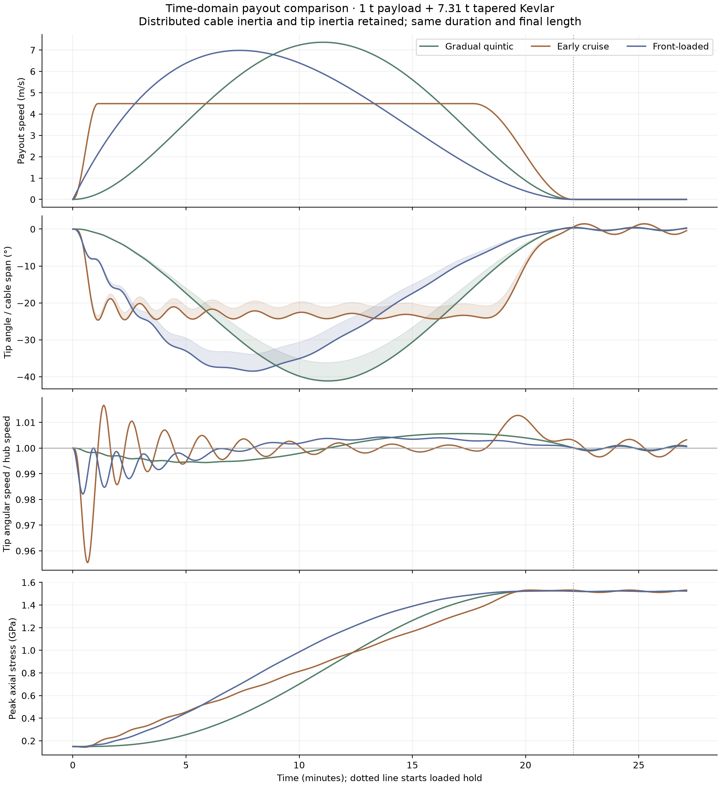
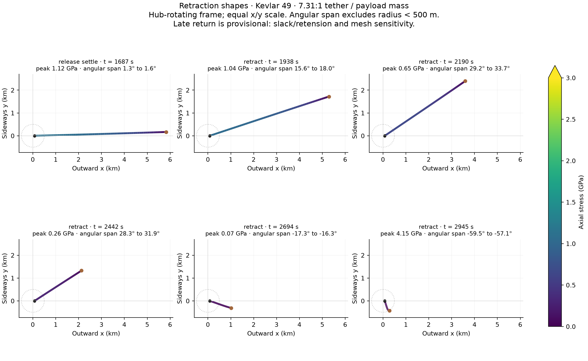
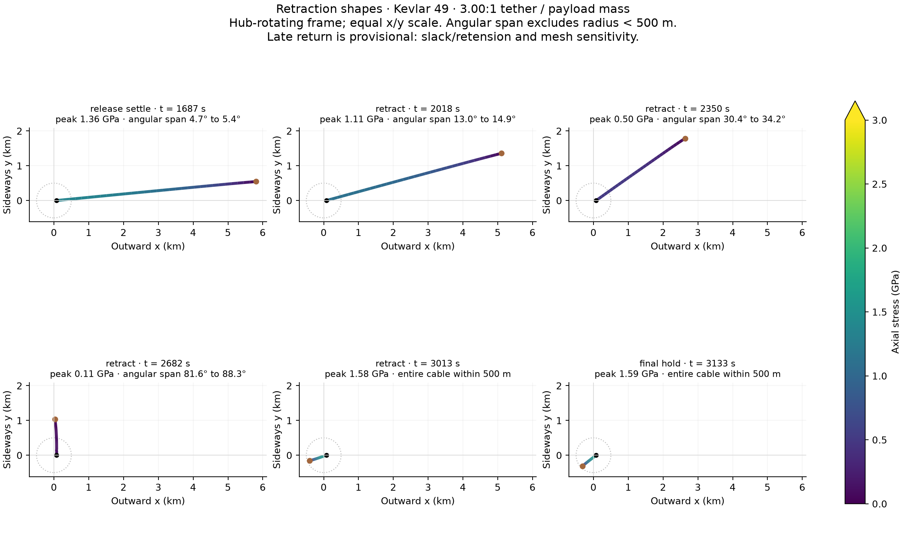

# Faster initial payout: does the angle dip disappear?

[Study overview](README.md) · [All saved results](results/README.md)

**Result:** a faster start substantially changes the angle history. A short ramp
into constant-speed payout replaces the broad −41° trough with an approximately
−23° plateau, but introduces startup oscillations. It still has local minima;
its most negative sampled tip angle is −24.67°. This is an exploratory control
comparison, not an optimal-control solution.

## These are time-domain simulations with inertia

The simulation integrates positions and velocities of a distributed, elastic,
tapered cable and a **1,000 kg payload plus 10 kg attachment**. Each cable cell
has mass; deployed mass changes as actual material passes through the feed point.
The cable can curve and lose tension. The commanded quantities are feed-point
rotation and paid-out unstretched length. Payload angle, angular speed, cable
shape and stress are outputs, not imposed equilibrium values.

The hub rotation is prescribed, so the hub drive supplies whatever reaction is
needed; finite motor torque, rover acceleration and drive saturation are not
modeled. Gravity perpendicular to the simulation plane is also excluded.
The saved `material_velocity_m_s` is relative to the rotating frame; the plotted
inertial tip angular speed adds the hub angular speed to that relative motion.

The comparison uses the lower-stress **7.31-tonne Kevlar taper**, the same
500 m initial paid-out length, 5,710.299 m final length, 1,326.697 s extension,
and 300 s loaded hold. All three start in the same radial co-rotating equilibrium
with zero payout speed. The original 3:1 case remains available in the overview.



| Command | Payout speed at 60 s | Most negative tip angle | Time of minimum | Peak extension stress |
| --- | ---: | ---: | ---: | ---: |
| Original gradual quintic | 0.220 m/s | −41.15° | 675 s | 1.528 GPa |
| Early cruise | 4.388 m/s | −24.67° | 66 s | 1.532 GPa |
| Front-loaded polynomial | 1.943 m/s | −38.50° | 476 s | 1.525 GPa |

Negative angles lag the feed station's rotating radial direction. The shaded
bands show the cable's instantaneous angular span outside 500 m, whereas the
solid line follows the endpoint. The minima are sampled at approximately 2 s
intervals. They are not exact continuous-time extrema.

The early-cruise command reaches 4.488 m/s in 66.3 s, holds that speed until
1,061.4 s, then smoothly slows to zero over 265.3 s. Its velocity ramps are
raised cosines. The front-loaded command uses normalized length
`f(x) = 6x² − 8x³ + 3x⁴`, where `x = t / extension_duration`; payout speed peaks
one-third of the way through. It starts at zero speed with a finite acceleration
step. The original command is `f(x) = 10x³ − 15x⁴ + 6x⁵`.

The angle is therefore not forced to follow the original trough. However,
starting radially aligned and finishing almost aligned while lagging during
extension naturally leaves an interior minimum somewhere. Faster initial
payout alone does not guarantee a monotonic angle history. Starting from a
prepared, already-lagging moving state would be a different initial-condition
experiment; it is not silently substituted here.

The early-cruise run briefly drops the endpoint's angular speed to **95.55%** of
hub speed, then overshoots to **101.67%**. Those oscillations demonstrate the
inertial response to the rapid startup. They are not a static force-balance
construction. Peak extension stresses barely change between these commands;
that does not establish equal wave behavior at release or during retraction.

- [Early-cruise shape sequence](results/kevlar_early_cruise_n32_extension.png)
- [Front-loaded shape sequence](results/kevlar_front_loaded_n32_extension.png)
- [Numerical comparison](results/payout_control_comparison.json)

## Retraction sequence

These are the **original complete-cycle runs**, after abrupt payload release.
The 10 kg attachment remains; the 1,000 kg payload does not return. The new
payout alternatives above stop after loaded hold and have not been substituted
into these return runs.



The sequence begins after 60 s of release-wave settling. The reverse length
command then pulls the tether back toward 500 m deployed length. In the rotating
frame the cable moves ahead of the feed radial direction, swings widely, and
fails to settle into a controlled return. The lower-stress taper's run ends
before completing retraction at an unresolved slack/retension event. Its late
stress spike is sensitive to the assumed damping and discretization, **not a
reliable prediction of physical rope failure**.



The 3:1 run completes the commanded return and subsequent hold, but completion
is not evidence of a usable docking or neighbor-clearance trajectory. Panels
marked “entire cable within 500 m” have no outside-500 m angular envelope.

## Checks, limits and reproduction

All three control comparisons use 32-cell BDF integration and the same unmeasured
axial damping timescale of 0.02 s. The original extension has a separate 64-cell
comparison; the two new controls have not yet been independently refined.
Endpoint and derivative checks verify the prescribed length/speed/acceleration
functions. Existing equilibrium, fixed-length energy and moving-coordinate
checks remain applicable. Late return uncertainty and the open moving-boundary
energy-balance check are explained in the [study overview](README.md).

Run each new control with the repository Python environment, for example:

```bash
MPLCONFIGDIR=/tmp/lunar-sling-mpl-cache OPENBLAS_NUM_THREADS=1 \
.env/hub/bin/python -c 'from sling_launcher.spooled_tether_2d.model import Config; from sling_launcher.spooled_tether_2d.run import run; run(Config(name="kevlar_early_cruise", payout_profile="early_cruise", extension_only=True))'
```

Repeat with both names changed to `kevlar_front_loaded` / `front_loaded`, then:

```bash
MPLCONFIGDIR=/tmp/lunar-sling-mpl-cache \
.env/hub/bin/python -m sling_launcher.spooled_tether_2d.compare_controls
```
