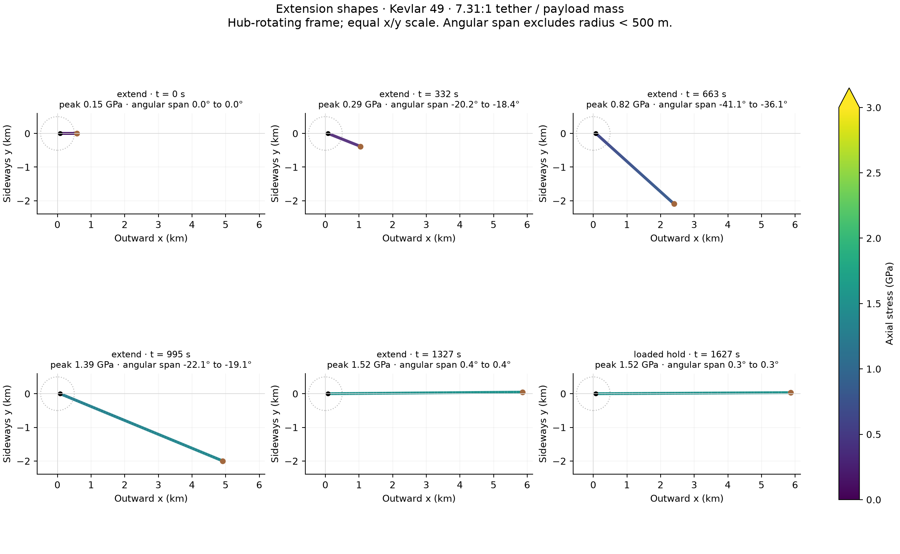
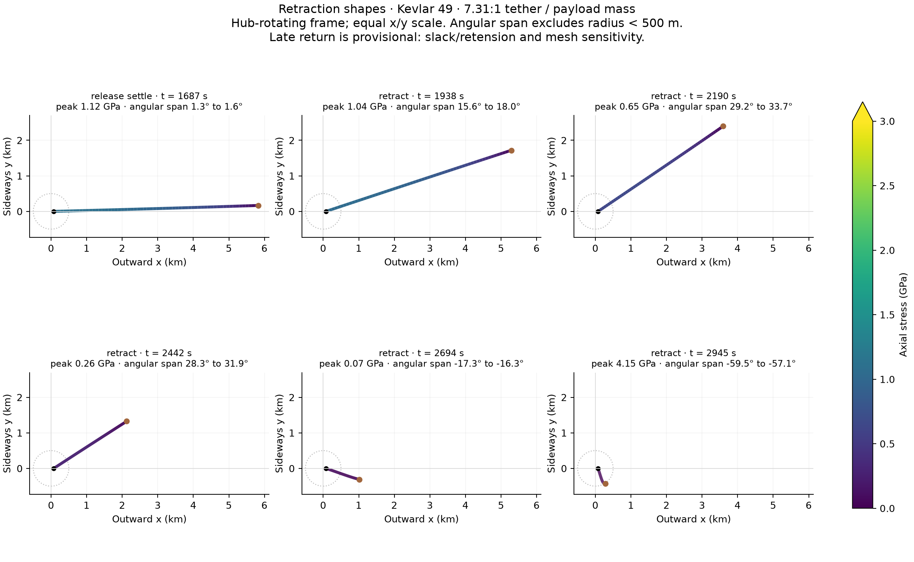
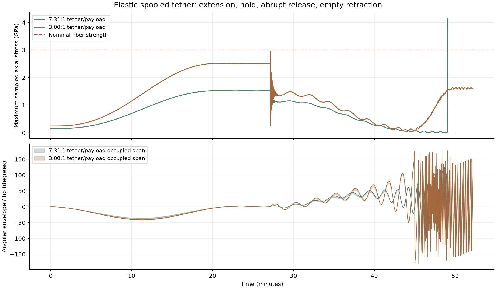

# Spooled tether in 2D: extension, release and empty retraction

**Initial dynamic shape investigation — 2026-11-08.** This is shared work for
[all spooled launcher designs](../README.md), including the
[staged multi-tether bank](../staged_spool_bank/README.md). It is not a new
optimized controller or a validated full-machine design.

- **[Shapes and numerical results](results/README.md):** time-stamped cable shapes,
  axial stress and angular occupancy for two Kevlar tapers. Extension is well
  reproduced on two meshes; late empty retraction is substantially more sensitive.
- **[Earlier point-mass study](../payout_control/README.md):** the simpler geometric
  precursor, with payout strategies and GIFs but no distributed tether mass.
- **[Multi-spool application](../staged_spool_bank/README.md):** uses the resulting
  swept geometry to investigate neighboring arms; clearance is not established yet.

## Faster-start controls and the retraction sequence

[Time-domain control comparison](CONTROL_COMPARISON.md) tests two faster-start
payout commands with payload and distributed tether inertia. Early cruise
reduces the broad angle trough to a roughly −23° plateau with startup
oscillations; the minimum remains −24.67°. The report also presents both
original retraction sequences together.

## Start with the shapes

The first plots use the thicker, 1.5 GPa static-design taper. Each panel is an
actual time snapshot in the **hub-rotating frame**, with stress along the cable
shown by color. Horizontal and vertical scales are equal. The payload can lag
behind the hub's radial direction; it is not constrained to point straight out.
The small dotted circle marks the 500 m hub-centered radius excluded from the
angular-envelope statistics.





**Late retraction is provisional:** this run stops at a damping-sensitive
slack/retension stress event near the end of return. Its precise late angle and
stress spike are not mesh-converged or a reliable material failure prediction.
The early/mid retraction shapes and large growth in angular excursion are the
useful warning from this first run. No continuation through a modeled rupture
is shown.

The requested **3:1** taper has its own
[extension snapshots](results/kevlar_ratio3_n32_extension.png) and
[retraction snapshots](results/kevlar_ratio3_n32_retraction.png). Both cases use
identical payout commands, rotation and payload; only tether sizing differs.

## What this first calculation shows

- The thicker taper reaches approximately **1.527 GPa** during extension and
  **1.697 GPa** during abrupt release. Those are dynamic model stresses, rather
  than simply repeating the 1.5 GPa sizing input.
- The **3:1** taper reaches approximately **2.519 GPa** during extension and
  **2.962 GPa** during abrupt release, close to the **3.0 GPa nominal fiber
  strength**. That does not leave a credible qualification margin for a finished
  rope, splices, fatigue or environmental degradation.
- The thicker line sweeps about **41° behind the reference radial line** during
  extension, then finishes the loaded hold within about **±0.45°**. Its occupied
  angular width at a single instant during extension is about **5°**. A narrow
  instantaneous shape can still move through a large angular range over time.
- The empty return develops growing, large angular excursions under this simple
  open-loop length command. **No neighbor-safe retraction program has been found
  in this checkpoint.** Slower or feedback-controlled return, end-device mass,
  release shaping and damping need investigation before arranging adjacent arms.



The filled angular band spans every point of the piecewise-linear cable outside
500 m radius, including intersections of segments with that cutoff circle. The
solid line is the tip angle. Where the entire cable is inside 500 m, the
occupied band is empty (saved as NaN), while the tip angle is still shown. Angles are relative to the feed station's rotating
radial line, not inertial longitude. A union of these bands over time is different
from any single snapshot and depends on the chosen phase interval.

For a hypothetical 30-arm bank, ±6° lines on the separate angular figures are
**only an illustrative allocation**. The neighboring tethers have their own
motion and timing. Neither staying inside nor exceeding a line alone certifies
or disproves a particular phased layout.

## Kevlar inputs and why 3:1 is aggressive

[Toray–DuPont's Kevlar property table](https://www.td-net.co.jp/kevlar/data/),
checked 2026-11-08, gives Kevlar 49 density **1,450 kg/m³**, tensile modulus
**112.4 GPa**, and nominal tensile strength **3.0 GPa**. These are fiber/yarn
reference properties, not a lunar-qualified cable specification. We use them
for an initial axial material model and distinguish them from selected allowances.

| Quantity | Aggressive 3:1 case | Thicker comparison |
| --- | ---: | ---: |
| Useful payload | 1,000 kg | 1,000 kg |
| Retained tip/attachment mass | 10 kg | 10 kg |
| Whole tether mass | 3,000.00 kg | 7,310.90 kg |
| Tether / useful payload | 3.00 | 7.31 |
| Static taper sizing stress | 2.45294 GPa | 1.50000 GPa |
| Fiber area, distal tip | 201.89 mm² | 330.16 mm² |
| Fiber area, root | 466.98 mm² | 1,300.93 mm² |

The extra 10 kg remains after payload release; it is a declared provisional
attachment mass, not a sized mechanism. Including it makes the 3:1 sizing stress
slightly higher than the earlier power-only example. The 1.5 GPa case is a
factor-of-two **fiber-strength screening allowance**, not a certified safety
factor for an actual rope. Finite axial extension then increases release radius
and loads slightly above the inextensible static design.

A Kelvin–Voigt axial damping timescale **0.02 s** is an explicit, **unmeasured**
input. It is not justified by the manufacturer table. It damps longitudinal
strain motion; no external transverse drag or artificial lateral stabilizer is
added. Retension stresses, in particular, depend strongly on this assumption.

## Motion and scope

The feed point follows the inherited 76.789 m track at 22.352 m/s. Its angular
speed is 0.291081954 rad/s. The cable has **5,710.299 m unstretched full length**;
its actual shape, stretched length, tip position and velocity are outputs.
No catcher-targeting adjustment is made for the elastic/dynamic release state.

The sequence is:

1. Start with **500 m already paid out**, in loaded, co-rotating elastic equilibrium.
   This excludes initial pickup and the most singular near-spool region, matching
   the current interest in motion after clearing the hub.
2. Extend to full unstretched length in **1,326.697 s**, using the previous quintic
   smoothstep with zero endpoint payout speed and acceleration.
3. Hold loaded for **300 s**.
4. Detach the 1,000 kg payload **instantaneously**, keeping the 10 kg tip device
   and its position/velocity. This deliberately exposes release waves; a gentle
   release mechanism has not been substituted implicitly.
5. Evolve for **60 s** after release, then retract toward **500 m deployed length**
   over 1,326.697 s with the reversed smoothstep.
6. Where the model completes return, hold for a further **120 s**. Stop at a
   nominal-strength threshold event instead of simulating rope fracture.

This is therefore an outer-deployment/return investigation, **not docking onto
an empty spool**. The stop threshold uses total modeled axial stress. At the
one-sided dashpot's slack/taut transition that stress can jump, so the reported
endpoint can exceed 3 GPa rather than land exactly on it. Such an endpoint is
flagged as an unresolved constitutive/numerical event, not a measured break load.

The plane is horizontal. Out-of-plane gravity/sag, terrain, spool bend/contact,
thermal response, aerodynamic forces, full rover dynamics and adjacent tethers
are excluded. The taper and retained mass have inertia; the cable can stretch,
curve, oscillate and lose tension. It cannot support compression. At present it
has no bending stiffness or self-contact model, so folded/slack late states
require particular caution.

## Numerical method: spooling material, not rescaling a fixed chain

The material coordinate s runs from the thick root (0) to the distal tip (L).
At deployed unstretched length q, the active material is **s ∈ [L−q, L]**: the
thin end is deployed first and recovered last. A computational coordinate ξ in
[0,1] maps to `s = L − q + q ξ`. Each mesh cell therefore contains changing
material and changing taper as the spool runs.

This moving-domain formulation includes material-advection terms. It does not
pretend that every existing cable segment stretches proportionally to q, or
that stored tether mass is already spread along the deployed cable. Variable-
length elastic-tether modeling has a substantial literature; see, for context,
[Lee, Leok and McClamroch (2010)](https://arxiv.org/abs/1010.1724). This implementation
uses the equations below and SciPy, not that paper's particular integrator.

In the hub-rotating frame let X(ξ,t) be position, V = X_t mesh velocity and J a
90° rotation. Set

```
w = (1 − ξ) qdot/q
beta = (1 − ξ) [qddot/q − 2(qdot/q)²]
v_material = V + w X_xi

X_tt = (T t_hat)_s / lambda
       + Ω² X − 2Ω J v_material
       − 2w V_xi − w² X_xixi − beta X_xi
```

Axial strain is `epsilon = |X_xi|/q − 1`; its material rate includes the same
advection. For positive strain the force law is
`T = max(0, E A [epsilon + tau D(epsilon)/Dt])`; for nonpositive strain, T = 0.
Lumped masses represent distributed cable and the end load. Axial forces are
finite-volume tension differences; convection uses centered differences.
The feed point is fixed in the rotating frame; **only the reel length and feed
motion are prescribed**, not payload angle or radius.

The coarse run uses 32 cells with implicit BDF; the thicker comparison also uses
64 cells with implicit Radau. Both retain inertia and Coriolis terms. Output
sampling is 2 s during slow phases and 0.02 s after release; stress maxima at
accepted integration steps are recorded separately so samples do not conceal
short spikes. Stiff-solver tolerances and the damping model are saved with each run.

## Verification and limits of the current shapes

[Validation results](results/validation.json) include:

- Discrete static equilibrium: residual acceleration below 10⁻⁵ m/s².
- An undamped, fixed-length perturbation: rotating-frame energy conserved to
  better than 10⁻⁵ relative (observed about 2×10⁻¹²).
- A moving-coordinate manufactured solution: the material-advection acceleration
  cancels for a stationary material line, to roundoff.
- A **combined mesh-and-integrator comparison** of 32-cell BDF and 64-cell Radau.
  Extension tip positions agree within **0.06 m**, loaded hold within **0.12 m**,
  and release-settling positions within **1 m**. Extension peak stress changes
  by about **0.0014 GPa**.

Late retraction is not comparably converged: tip discrepancies reach about
**79 m / 9.3°**, and the terminal stress spike depends on slack/retension handling.
The thick-case computed spikes around **4.1 GPa** are dominated by the assumed
viscous/contact transition; they must **not** be presented as a robust prediction
that Kevlar breaks at that point. The robust result is that this open-loop return
is not yet a controlled, small-envelope trajectory. The 3:1 run is exploratory
and has not received its own mesh-refinement study.

The checks do not yet close the full moving-boundary energy balance over an
entire payout/retrieval cycle. That, measured/alternative damping laws and better
slack/retension treatment are required before quantitative collision-clearance
or hardware qualification claims. The snapshots are useful for choosing the
next control experiment, not final placement of neighboring tethers.

## Files and reproduction

- [model.py](model.py): material/taper inputs, moving-domain equations and phase solver.
- [run.py](run.py): saved shape, stress, velocity, angular-envelope and summary data.
- [plot.py](plot.py): static snapshot sheets and stress/angle plots, in PNG and SVG.
- [validate.py](validate.py): local mechanics checks and saved-run comparison.
- [Results index](results/README.md): direct figure links and NumPy/JSON artifacts.

```bash
MPLCONFIGDIR=/tmp/lunar-sling-mpl-cache OPENBLAS_NUM_THREADS=1 \
  .env/hub/bin/python -m sling_launcher.spooled_tether_2d.run --nodes 32
MPLCONFIGDIR=/tmp/lunar-sling-mpl-cache OPENBLAS_NUM_THREADS=1 \
  .env/hub/bin/python -m sling_launcher.spooled_tether_2d.run --nodes 64 --method Radau
MPLCONFIGDIR=/tmp/lunar-sling-mpl-cache OPENBLAS_NUM_THREADS=1 \
  .env/hub/bin/python -m sling_launcher.spooled_tether_2d.run --nodes 32 --ratio3
MPLCONFIGDIR=/tmp/lunar-sling-mpl-cache OPENBLAS_NUM_THREADS=1 \
  .env/hub/bin/python -m sling_launcher.spooled_tether_2d.validate
MPLCONFIGDIR=/tmp/lunar-sling-mpl-cache \
  .env/hub/bin/python -m sling_launcher.spooled_tether_2d.plot
```

The next step is to decide which shapes and phase intervals deserve control
changes. Slower/feedback-controlled empty return and finite-duration payload
unloading should be tested before a multi-arm collision simulation. No
optimal-control algorithm is claimed here.
