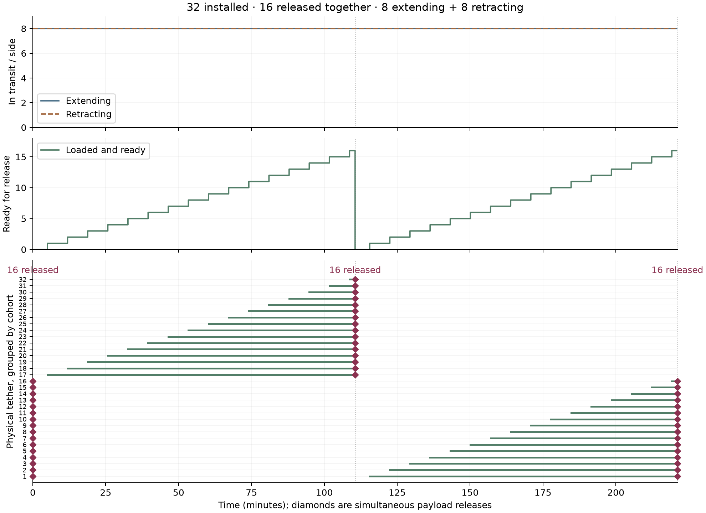
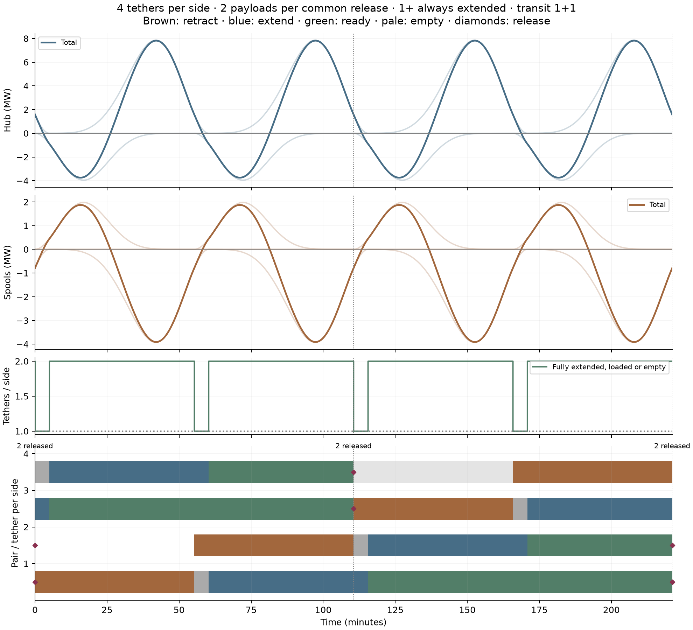
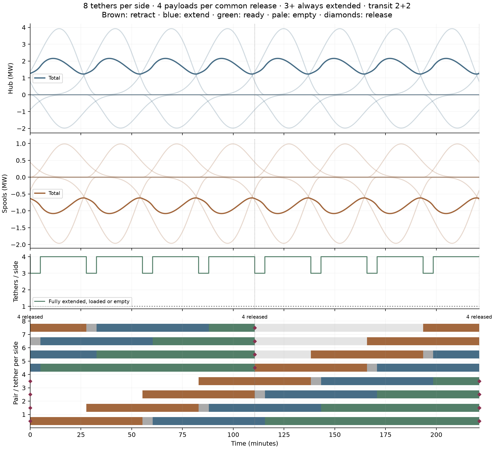
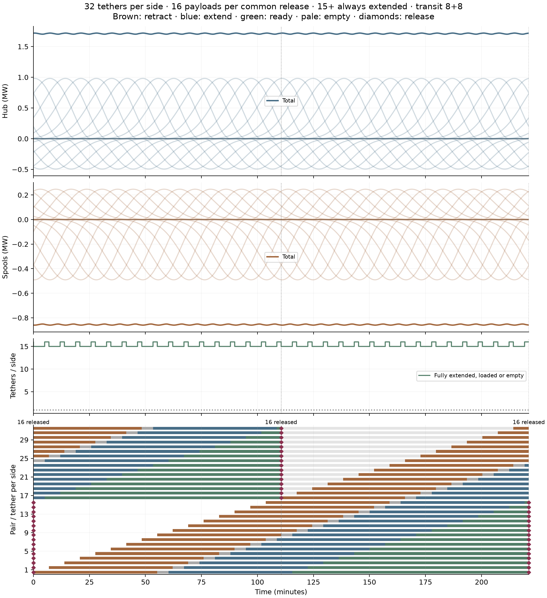

# Modular spool banks: large batches with smooth power

[Launcher guide](../README.md) · [Slider-straw concept](../lunar_slider_straw/README.md) ·
[Shared 2D tether dynamics](../spooled_tether_2d/README.md)

**Investigation in progress.** Divide a fixed delivered mass among many smaller,
independently spooled payloads. Prepare them at staggered times, hold them at full
extension, and release a large batch at each catcher window.

The reference sequence has **4, 8, 16 and 32 tethers per side**. Half the bank
releases every window; each spool repeats every **two windows**. Useful delivery
is fixed at **2,000 kg per window**. In the 32-tether case, **16 × 125 kg** payloads
release together, with **99.50% net input utilization** and **0.851–0.860 MW** net
shaft power. The ideal installed tether inventory stays constant as payloads and
cables are divided into smaller modules.

**Scheduling controls:** installed count N, simultaneous release count B, and
outbound/return transit counts K_out and K_back. The [integer-concurrency study](#5-choose-the-in-transit-count-independently)
holds 32 installed and 16 released fixed while varying transit count. Its explicit
cohort diagram shows all sixteen releases together.

**Straw design handoff:** the [constant-speed straw calculation](../lunar_slider_straw/README.md)
uses this 16-tether reference (eight released, 4+4 in transit), replacing smoothstep
travel with equal constant-speed payout and return. It adds transverse contact loads,
common-shaft recovery, friction and guide-mass screens.

## 1. Set delivery first, then choose the modules

Let T be the catcher-window interval, N the number of tethers on the payload side,
B the number released per window, and M the required useful mass per window.
The module payload is `m = M/B`. Processing starts every `T/B`; a spool's reuse
interval is `NT/B`. Thus **B = N/2 gives a two-window reuse interval at every size**.

N counts one side: 32 payload tethers plus 32 symmetric opposite tethers make
32 payload–counterweight pairs. Powers and installed tether masses include both
sides. Delivered mass and mass flow count useful payloads only.

The cycle is:

**Retract empty → reload → extend loaded → hold for common release → wait empty.**

Each completed load waits for the next common boundary. The bank reference
retains a five-minute reload and imposes no additional minimum loaded hold. Exactly B payloads release at each boundary. Empty extended cables wait for
their return slots while other cables continue moving. At least one cable per side
must remain fully extended, including empty cables. This certifies geometric reach;
required guide tension and straw stability need a structural calculation.

## 2. Establish the power of one pair (illustrative cycle)


[PNG](results/single_pair_power.png) · [SVG](results/single_pair_power.svg)

Each travel phase lasts **0.4T = 44.223 minutes**. Reload and loaded hold each
last five minutes; the remaining idle interval is 12.112 minutes.
Positive shaft power supplies work; negative shaft power is available for regeneration.

| Phase | Hub drive | Spool drive |
| --- | --- | --- |
| Loaded extension | Supplies angular momentum | Regenerates as the payload pulls outward |
| Stationary full-extension hold | Zero ideal shaft power | Zero ideal shaft power, with holding tension |
| Payload release | Payload carries away kinetic energy | No resolved shaft-power pulse |
| Empty-tether retraction | Regenerates as rotational inertia falls | Supplies work to pull the cable inward |

“Hub drive” denotes the drive maintaining rotation, including wheel motors in a
wheeled design. The power accounting includes the mass of the tapered tether,
both deployed and stored, as well as the payload and radial motion.

| Single-pair illustration input | Value |
| --- | ---: |
| Payload / opposite mass | 1,000 / 1,000 kg per pair |
| Tether material per arm | 3,000 kg; 3:1 tether/payload mass |
| Rotation | 0.2910819542 rad/s = 2.77963 RPM |
| Feed-station / release radius | 76.789 / 5,787.088 m |
| Release speed | 1,684.517 m/s |
| Release-window period T | 6,633.486 s = 110.558 min |
| Reload / minimum loaded hold | 300 / 300 s |
| Motion program | Quintic smoothstep; zero endpoint speed and acceleration |
| Taper root/tip area ratio | 2.3250 |
| Specific working stress for this taper | 1.68129 MJ/kg |
| Corresponding stress at density 1,450 kg/m³ | 2.43787 GPa |

The stress follows from the illustrative 3:1 taper. A real cable requires a material
and working allowance appropriate to its service conditions. The inherited T is
a comparison clock; orbital interception and release headings require a separate model.

## 3. A consistent 4 → 8 → 16 → 32 sequence

All four cases use these controls:

```
Delivered useful mass per window M = 2,000 kg
Release count B                   = N/2
Payload per tether                = 2,000/B kg
Tether mass per arm                = 3 × module payload
Processing start interval         = T/B
Physical spool reuse               = 2T
Extending / retracting counts     = N/4 each, continuously
Retraction / extension             = 0.5T each (55.279 minutes)
Reload / minimum loaded hold       = 300 seconds / zero
```

Increasing N subdivides the same workload into more overlapping motions. It does
not increase either travel duration or the spool's two-window reuse period.
All rows deliver **0.3015006 kg/s**, with average shaft powers of **+1.7108 MW hub**,
**−0.8554 MW spools**, and **+0.8554 MW net**.

| Tethers per side | Released together/window | Extending + retracting | Payload each (kg) | Minimum fully extended/side | Shortest actual loaded hold (min) |
| ---: | ---: | ---: | ---: | ---: | ---: |
| 4 | 2 | 1 + 1 | 1000 | 1 | 50.279 |
| 8 | 4 | 2 + 2 | 500 | 3 | 22.640 |
| 16 | 8 | 4 + 4 | 250 | 7 | 8.820 |
| 32 | 16 | 8 + 8 | 125 | 15 | 1.910 |

Every row delivers 2,000 kg per window and uses 24 tonnes of ideal tether material
across both sides. The half-window phases allow the specified constant integer
transit counts. The shortest loaded wait in the 32-tether reference is 1.910
minutes. A longer required settling time would need a schedule adjustment.

With four per side, one pair returns from 0 to 0.5T, reloads until 0.5452T,
extends until 1.0452T, then waits loaded and releases at 2T. Its next return starts
after that release. The next pair starts T/2 later; two payloads release at each
window in established operation. Larger banks use closer starts, more simultaneous
transit slots and larger release cohorts.

For this regular two-window scheme, four is the minimum count satisfying the
full-extension criterion at the stated travel and loading times. Two would have
both cables processing during part of the cycle.

The **24-tonne tether inventory** is twice that of a single 2,000 kg payload pair
with 3:1 cables completing a one-window cycle. This is the inventory cost of a
two-window processing cycle. Further subdivision from 4 to 32 adds no ideal tether
mass. It does add reels, attachments and control channels; their masses are outside
this energy model. Minimum cable sizes and discrete hardware can also affect scaling.
For another delivery target, all payloads, ideal tether masses and powers scale
by `new M / 2,000`; durations and utilization percentages remain unchanged.

## 4. Present power as utilization

The headline quantity is **net input utilization**:

```
U_input = mean(P_hub + P_spools) / max(P_hub + P_spools)
```

For these net-consuming cycles this lies between zero and one. It measures average
net mechanical demand relative to the peak net supply requirement. A nearly flat
input approaches 100%. It is a load-factor-style measure, rather than conversion
efficiency. RMS power would describe another statistic; motor heating requires
RMS current or torque and a motor/loss model.

A shared supply can transfer regenerated spool power to the hub. Each drive still
needs its own power capacity. For bidirectional equipment, the table therefore
also lists **handling utilization = mean(|P|) / max(|P|)** and peak power magnitude.
Handling utilization counts both motoring and regeneration. Negative net intervals
still require storage, another consumer or disposal.

| Tethers per side | Net input utilization | Hub handling utilization | Spool handling utilization | Net min / max (MW) | Hub / spool peak magnitude (MW) |
| ---: | ---: | ---: | ---: | ---: | ---: |
| 4 | 21.88% | 47.12% | 47.12% | -1.8717 / 3.9092 | 7.8184 / 3.9092 |
| 8 | 79.30% | 79.30% | 79.30% | 0.6151 / 1.0787 | 2.1575 / 1.0787 |
| 16 | 97.55% | 97.55% | 97.55% | 0.8415 / 0.8769 | 1.7537 / 0.8769 |
| 32 | 99.50% | 99.50% | 99.50% | 0.8507 / 0.8597 | 1.7195 / 0.8597 |


[Overview PNG](results/bank_reference_sequence.png) · [SVG](results/bank_reference_sequence.svg) ·
[Utilization and capacity table CSV](results/power_utilization.csv)

The 32-module case combines substantial batching with nearly constant power.
The numerical results retain peak-to-peak variation as a diagnostic. Utilization
is a different, physically defined measure; it does not change the simulated powers.

## 5. Choose the in-transit count independently

Three explicit scheduling inputs describe the bank:

- **N:** installed tethers per side.
- **B:** payloads released simultaneously at each LLO window.
- **K_out and K_back:** tethers extending and retracting at any instant.

At fixed B, start an extension and a retraction every `Δ = T/B`. To maintain
integer, constant transit counts, use:

```
extension duration = K_out × Δ
retraction duration = K_back × Δ
physical spool reuse interval = N × Δ
payload per tether = delivered mass per window / B
```

As each travel phase ends, another begins. Reloading is a separate state and has
its own station occupancy. Each spool reloads between its return and its next
extension. Thus constant transit counts specify constant job occupancy; the actual
quintic motions still speed up and slow down and can produce power ripple.

N, B and the transit counts are independently selectable **within the inventory
and release-readiness constraints**. They are not fixed ratios of one another.
For this uniformly phased, aligned-start schedule, including the minimum loaded
hold, the readiness condition is

```
K_out + K_back + (reload + minimum loaded hold)/Δ ≤ N − B + 1.
```

The calculation also checks the continuous full-extension requirement between
all scheduling events. Different timing phases or loading arrangements would
require their own readiness check.

### Hold N = 32 and B = 16; vary only transit concurrency

Every row releases **all 16 payloads together**, each of mass 125 kg, delivering
2,000 kg per window. Every spool repeats after 2T. Equal outward and return
concurrency is used here; there are twice K tethers moving in total per side.
The model uses zero speed and acceleration at each travel endpoint.

| Extending | Retracting | Total in transit/side | Time each way (min) | Peak spool speed (m/s) | Net input utilization | Minimum loaded hold |
| ---: | ---: | ---: | ---: | ---: | ---: | ---: |
| 1 | 1 | 2 | 6.910 | 25.82 | 35.54% | 5 min |
| 4 | 4 | 8 | 27.640 | 6.46 | 95.69% | 5 min |
| 7 | 7 | 14 | 48.369 | 3.69 | 99.24% | 5 min |
| 8 | 8 | 16 | 55.279 | 3.23 | 99.50% | 0 min |

**One extending and one retracting** is precisely the two-in-transit option.
It processes the same release batch with faster travel. **Seven each way** gives
nearly half a window for each travel phase while retaining the five-minute
minimum loaded hold. **Eight each way** gives exactly half a window; with the
five-minute reload, it requires relaxing that arbitrary five-minute minimum
loaded hold to fit 32 installed tethers. The zero-minimum-hold row allows release
once a tether has finished extending; any real settling requirement must be
supplied by the dynamics model.

The main sequence uses integer occupancy throughout: 1+1, 2+2, 4+4 and 8+8
for 4, 8, 16 and 32 installed tethers per side, respectively.

### Verify that sixteen release together



[PNG](results/cohort_release_16_reference.png) · [SVG](results/cohort_release_16_reference.svg)

This figure uses the normal reference: **eight extending and eight retracting**.
The ready population grows from zero to sixteen, then all sixteen release at the
common boundary. Each column of sixteen
diamonds is one simultaneous launch cohort. Green segments show the loaded waits;
the tethers are ordered by cohort so their common release is visually apparent.

The release-event audit also confirms that the preceding 16-of-32 calculation
released sixteen at each boundary. Its schedule plot interleaved spool identities
and showed no explicit release markers, making the grouping difficult to read.
All detailed schedule plots now mark the individual releases with diamonds and
label the count at each window. The data include event time, tether identity,
ready time and actual loaded-hold duration for every release.

The fast 28-of-32 example remains in the saved results as a reserve-size sensitivity.
It is outside the main design sequence. A smaller reserve constrains feasible
transit occupancy; it does not define the transit count for the 16-of-32 design.
No friction or structural feasibility claim is inferred from travel speed alone.

[All transit-control metrics and release events](results/transit_controls.json) ·
[Two-in-transit schedule](results/bank_32_transit_1.png) ·
[Eight-in-transit schedule](results/bank_32_transit_4.png) ·
[Fourteen-in-transit schedule](results/bank_32_transit_7.png) ·
[Sixteen-in-transit schedule](results/bank_32_transit_8.png)

## 6. Detailed schedules for the modular sequence

Each plot shows two release windows, individual power contributions and the total,
continuously extended counts, and each spool's processing sequence. Dotted lines
are common-release boundaries. The machine is already in repeating operation;
startup requires a separate plan.

### 4 tethers per side



[PNG](results/bank_4_reference.png) · [SVG](results/bank_4_reference.svg) · [Saved histories](results/bank_4_reference.npz)

### 8 tethers per side



[PNG](results/bank_8_reference.png) · [SVG](results/bank_8_reference.svg) · [Saved histories](results/bank_8_reference.npz)

### 16 tethers per side


[PNG](results/bank_16_reference.png) · [SVG](results/bank_16_reference.svg) · [Saved histories](results/bank_16_reference.npz)

### 32 tethers per side



[PNG](results/bank_32_reference.png) · [SVG](results/bank_32_reference.svg) · [Saved histories](results/bank_32_reference.npz)

## 7. Governing energy balance and scope

Let q be deployed cable length, I(q) the rotational inertia of deployed and stored
cable plus attached masses, and Mr(q) the radially moving mass. Primes denote
q derivatives. The thin distal cable end deploys first. Stored cable remains at
the feed-station radius. At fixed angular speed Ω:

```
P_hub   = I′(q) qdot Ω²
P_spool = [Mr(q) qddot + ½ Mr′(q) qdot² − ½ I′(q) Ω²] qdot
K       = ½ I(q) Ω² + ½ Mr(q) qdot²
```

Between loading and release events, `P_hub + P_spool = dK/dt`. Cable moment
integrals provide I and its derivative. Loading attaches masses already co-rotating
at the station, supplying a boundary energy of **0.4996 MJ per 1,000 kg payload pair**. Release
carries away **2,837.60 MJ per 1,000 kg payload pair**. Net shaft work over a complete cycle is
**2,837.10 MJ per 1,000 kg payload pair**, independently of how long its travel and holds take.

Stationary holds consume zero shaft work in this ideal model. Actual holding
losses, loader work, motor efficiencies and power electronics require further
accounting. Negative net intervals require storage, another load or energy disposal.
Installed tether material is constant across the half-bank modular sequence;
reels, guide structures, frames and power hardware add to the complete mass budget.

The calculation prescribes straight radial co-rotation. Flexible tethers develop
angles to transmit tangential forces; neighboring-tether clearance, elastic stress,
release waves and dynamic stability require the [2D dynamics study](../spooled_tether_2d/README.md).
After common release, extended supporting tethers may all be empty. Their own
centrifugal tension remains, but straw integrity requires a structural calculation.
This study certifies continuous full extension and regular release counts.

These energies scale linearly with each module's payload. The reduced model uses
rigid co-rotation and excludes friction and electrical conversion losses.

## 8. Reproducibility and next work

- [Model](model.py): taper integrals and single-pair motion and power.
- [Report generator](report.py): modular sequence, 28-of-32 check and figures.
- [Inputs, powers, utilization and validation](results/summary.json).
- [Single-pair history](results/cycle_template.npz) and [reference taper](results/taper_profile.npz).

Checks enforce delivery count, payload normalization, energy conservation,
full-extension continuity, release readiness and cable-inventory refinement.

```bash
MPLCONFIGDIR=/tmp/lunar-sling-mpl-cache OPENBLAS_NUM_THREADS=1 \
  .env/hub/bin/python -m sling_launcher.staged_spool_bank.report
```

Next steps are control optimization, release and guide dynamics, mechanism mass
accounting, and orbital batch targeting. The present result is a steady scheduling
and energy baseline for those investigations.
