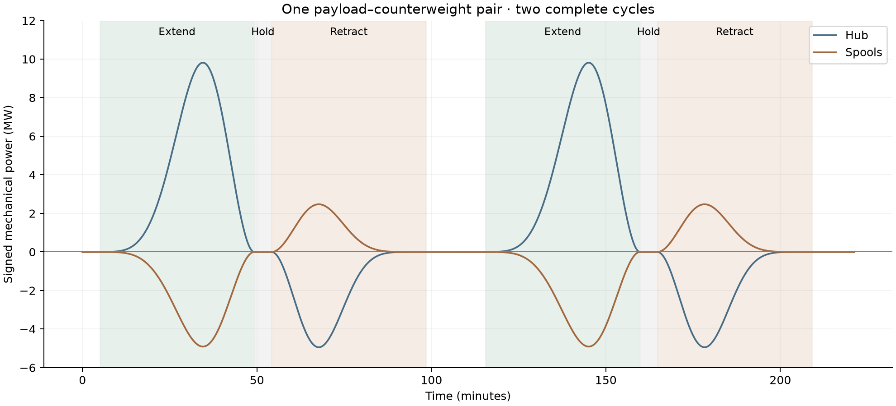
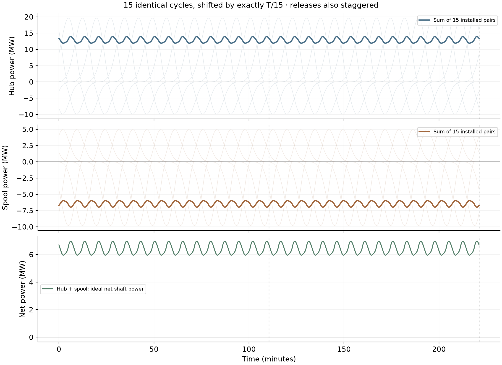
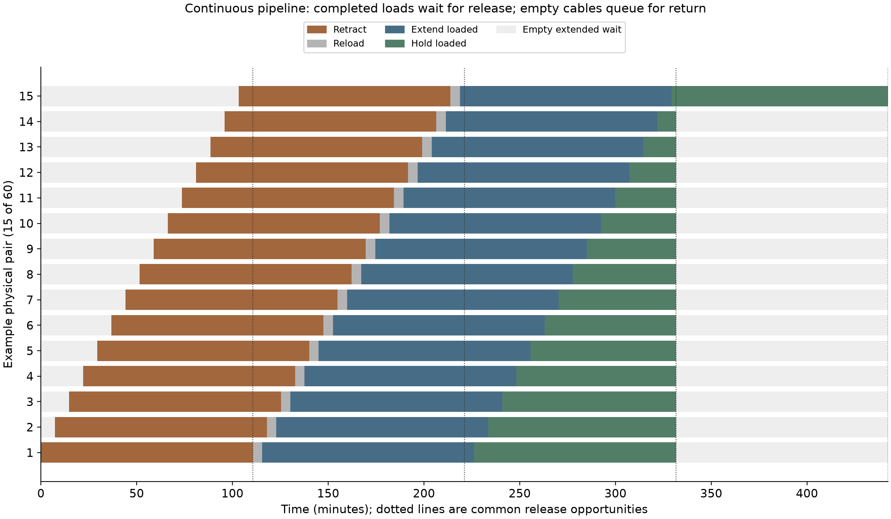
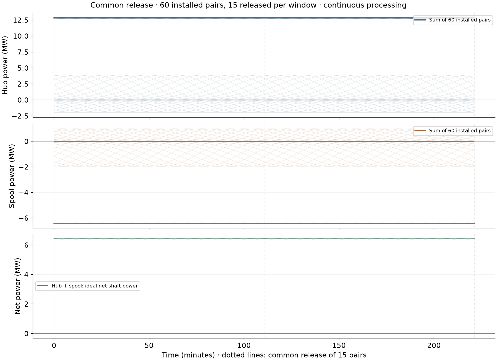

# Staged multi-tether lunar sling: a bank of spools

**New design variation and article working outline — 2026-11-08.**
Status: signed-power baseline implemented; shared
[2D spool dynamics](../spooled_tether_2d/README.md) now has initial shape/stress results.
Multi-arm clearance and controlled return remain unresolved.
[Launcher guide](../README.md) · [Original spool design](../publication/README.md) ·
[Conveyor comparison](../architecture_comparison/README.md)

## Article thesis: prepare separately, release as a group

Instead of a single payload–counterweight pair, give the rotating launcher many
independently operated tapered tethers. Extend them at different times and hold
the payloads at full radius until the desired LLO release window. In this proposal,
a rotating tether can retain a prepared payload at launch speed; the preparation
schedule need not coincide with the release schedule. A group could then be sent
toward the catcher as a batch rather than one payload per preparation cycle.

This is the proposed distinguishing advantage to develop in the article. Exact
release headings, times and common-catcher arrival geometry are not solved here,
and no historical-priority or exclusivity claim has been established. “All ready
for one window” is the design objective; simultaneous detachment in the power
model is a mechanical scheduling simplification, not a demonstrated intercept.

Tapered lines retain the mass-versus-working-stress tradeoff from the
[architecture comparison](../architecture_comparison/README.md). They can trade
more material and taper for lower stress rather than encounter the uniform
single-loop conveyor's self-stress floor. The illustrative **3:1 cable/load mass
ratio** below is one point on that tradeoff, not evidence that any low-grade
material meets its required stress.

## First result: one pair, two complete cycles

Positive power means shaft work supplied to the moving system. Negative power
means shaft work available for regeneration. “Hub” means the drive maintaining
rotation; it need not be a motor at the physical center pivot. “Spools” sums the
two opposed reels. No electrical efficiencies are folded into these curves.



[PNG](results/single_pair_power.png) · [SVG](results/single_pair_power.svg)

| Phase | Hub | Spools | Reason |
| --- | --- | --- | --- |
| Extend loaded | Positive | Negative | Main drive supplies angular momentum; outward payout drives the reel brake. |
| Hold fully extended | Zero in ideal model | Zero in ideal model | Nonzero holding tension, but no radial motion or change in rotational inertia. |
| Release | No resolved shaft-power pulse | No resolved shaft-power pulse | Released masses carry away their kinetic energy; release transients are excluded. |
| Retract empty tether | **Negative** | **Positive** | Decreasing rotational inertia returns work through the main drive; reels pull inward. |

The return-side hub regeneration is real in this imposed constant-RPM energy
balance. An unbraked assembly would instead tend to speed up as its inertia falls.
Finite retraction work remains even after payload release because the tethers
have mass. Friction and holding-system losses would make the ideal zero-power
holds nonzero in a real installation.

### Single-pair and original staggered baseline

| Input / derived quantity | Value |
| --- | ---: |
| Useful payload / opposite disposable mass | 1,000 / 1,000 kg per pair |
| Tether per arm / per pair | 3,000 / 6,000 kg |
| Payload pairs in bank | 15, hence **30 moving tethers** |
| Total bank tether inventory | 90 tonnes |
| Rotation | 0.2910819542 rad/s = 2.77963 RPM |
| Feed-station radius / release radius | 76.789 / 5,787.088 m |
| Release speed | 1,684.517 m/s |
| Period T | 6,633.486 s = 110.558 min; inherited comparison clock |
| Loaded extension duration | T/5 = 1,326.697 s |
| Empty retraction duration | T/5 = 1,326.697 s |
| Reload duration | 300 s |
| Single-template loaded hold | 300 s |
| Remaining single-template idle time | 3,380.092 s |
| Payout law | Quintic smoothstep: zero speed and acceleration at both ends |
| Peak payout / retraction speed | About 8.07 m/s |
| Required specific working stress for 3:1 taper | 1.68129 MJ/kg |
| Root/tip fiber-area ratio | 2.3250 |
| Stress if density is 1,450 kg/m³ | **2.43787 GPa**; illustrative, not a qualified allowable |

The travel duration is an explicit initial scheduling choice. It leaves room
within the inherited period for different holds and phase offsets. It is not
an optimized control law or an inferred mechanical speed limit.

The model uses straight radial cable inventory with rigid rotation, adapting
[spooling_cycle.py](../spooling_cycle.py). A real flexible tether must develop
angles to transmit tangential force. That geometry is not established by these
energy curves; it is the next study described below. No additional radial guide
hardware has been designed or counted.

## Fifteen identical cycles, evenly phased

Each pair runs the single template shifted by **T/15 = 442.232 s**. Faint lines
show each individual contribution; heavy lines show their sum. These figures
show an already-running periodic bank over two periods, not a startup from rest.



[PNG](results/staggered_bank_power.png) · [SVG](results/staggered_bank_power.svg)

| Metric | One pair | 15 evenly shifted pairs |
| --- | ---: | ---: |
| Hub minimum / maximum | −9.885 / +19.629 MW | +11.912 / +13.937 MW |
| Spool minimum / maximum | −9.815 / +4.943 MW | −6.969 / −5.956 MW |
| Average hub power | +0.8554 MW | +12.8308 MW |
| Average spool power | −0.4277 MW | −6.4154 MW |
| Average ideal net shaft power | +0.4277 MW | +6.4154 MW |
| Net peak-to-peak variation | 14.756 MW | **1.012 MW** |

The summed net ripple is **15.8% peak-to-peak relative to its mean**. This supports
the power-smoothing premise, without claiming perfect flatness. Shape/time control
has not been optimized. The bank carries 15 times the useful mass per period:
**15 tonnes per T, or 2.26125 kg/s**, plus equal opposite discarded mass. It is not
a free increase in throughput at fixed installed tether mass. Rescaling each pair's
payload and cable mass by 1/15 would preserve the waveform shape at the original
single-pair mean throughput.

**Exact phase shifts also shift release times.** Thus this smooth graph does not
by itself demonstrate a bank that waits for one shared release window.

## Common release with a continuous processing pipeline

**Common release is compatible with nearly constant power.** Loaded tethers wait
at full extension for a release window; after detachment, empty extended tethers
wait for their return slot. Other tethers keep extending or retracting throughout.
Installed spool count provides the buffer between these schedules.

The example below preserves the payload, taper, RPM and **15 tonnes per window**
of the original bank. Each travel phase now lasts T, with a new return starting
every T/15. Sixty physical pairs provide a four-window reuse cycle. This is a
concrete scheduling example; spool count and travel times remain design variables.

| Pipeline quantity | Value |
| --- | ---: |
| Installed pairs / individual tethers | **60 / 120** |
| Common release interval | **110.558 min** |
| Pairs releasing at each window | **15** |
| Useful payload / opposite mass per window | **15 / 15 tonnes** |
| Useful throughput | **2.26125 kg/s** |
| Empty retraction / loaded extension | **110.558 min each** |
| Reload | **5 min** |
| Successive processing starts | **7.371 min apart** |
| Physical pair reuse cycle | **442.232 min** |
| Loaded wait at full extension | **9.741–112.929 min** |
| Peak payout speed | **1.614 m/s** |
| Installed tether material | **360 tonnes**, plus spool machinery |

Each pair retracts, reloads, extends, waits for its assigned common release, then
waits empty until its next return slot. At each window, 15 pairs are ready and
release; the other 45 pairs retain their current tasks. A fully spooled waiting
phase could also be inserted by adding inventory and adjusting the schedule.



[Schedule PNG](results/staged_schedule.png) · [SVG](results/staged_schedule.svg).
The schedule shows 15 of the 60 physical pairs over four windows; the other groups
follow the same sequence with time offsets.



[Power PNG](results/synchronized_bank_power.png) · [SVG](results/synchronized_bank_power.svg).
The power figure shows two windows of an established periodic operation.

| Power metric | Continuous common-release pipeline |
| --- | ---: |
| Mean hub drive | **+12.8308 MW** |
| Mean spool regeneration | **−6.4154 MW** |
| Mean net shaft input | **+6.4154 MW** |
| Hub range | **12.8217–12.8388 MW** |
| Spool range | **−6.4194 to −6.4109 MW** |
| Net peak-to-peak ripple | **8.53 kW / 0.133% of mean** |

The curves sum the actual quintic travel histories, including radial inertia.
Residual ripple comes from their discrete overlap. Common release occurs during
stationary full-extension holds and adds no shaft-power pulse in this model.
Slower travel increases overlap and reduces ripple; the extra installed tethers
supply the waiting inventory. Power smoothing and shared release therefore coexist
at unchanged average throughput and energy per payload.

This replaces the earlier schedule that required all 15 installed pairs to
finish a complete return-and-extension sequence between consecutive windows.
Its large power swings were a consequence of that scheduling restriction.
The pipeline is a steady-operation energy calculation. Startup, electrical losses,
release waves, neighboring-tether clearance and catcher targeting remain separate
engineering tasks. Waiting increases installed cable and mechanism mass; ideal
stationary holds consume zero shaft work.

## Power equations and energy accounting

Let q be deployed cable length, I(q) rotational inertia of both deployed and
stored tether plus the two attached masses, and Mr(q) the combined moving radial
mass. Primes below differentiate with respect to q. Cable material deployed first
is the thin distal end; material still on the spool remains in the rotational
inventory at station radius a. At constant Ω:

```
P_hub   = I'(q) qdot Ω²
P_spool = [Mr(q) qddot + ½ Mr'(q) qdot² − ½ I'(q) Ω²] qdot
K       = ½ I(q) Ω² + ½ Mr(q) qdot²
```

Within each fixed-load phase, `P_hub + P_spool = dK/dt`. Numerical cable moments
supply the inertia and its derivative. This includes deployed and stored cable
mass, radial motion and the changing radial moving mass; it is not a payload-only
power estimate. The taper is the same constant-stress exponential used in the
[comparative analysis](../architecture_comparison/README.md), sized by solving
for specific stress until each cable mass equals three times its attached load.

Loading is modeled as attaching a payload already co-rotating at station radius,
at zero radial speed. Its initial energy is an explicit boundary input:
**0.4996 MJ per pair**. This plot does not resolve the loader motor or its losses.
The two released masses carry **2,837.60 MJ per pair**. Over a closed cycle, modeled
net shaft work is their difference, **2,837.10 MJ**. The tether returns to its
initial state. Release impulses/waves and recovery of hardware attached to the
payload are excluded.

“Hub + spool” is ideal net mechanical work. Physically using negative power needs
regenerative drives and a power-transfer path; electrical losses increase input.
The common-release pipeline continuously transfers spool regeneration to the hub
drive. Its net shaft input stays positive. Electrical equipment and solar sizing
require conversion efficiencies and transient allowances beyond this calculation.

## Shared follow-up: angle histories and full 2D cable dynamics

The [separate 2D work item](../spooled_tether_2d/README.md) now implements an initial
elastic single-tether model, shape snapshots and angular envelopes. It applies
to all spooled designs, rather than only this bank. The requirements below remain
the broader control/clearance agenda; they are not all solved by that first run.
Revisit the
[point-mass payout GIF study](../payout_control/README.md) as a geometric starting
point, then model a single tapered tether with its distributed mass and elastic
response. The massless point model alone cannot establish neighboring-cable safety.

The principal outputs should be:

1. Payload inertial angle θ(t), rotating-frame lag θ(t) − Ωt, angular velocity,
   and angle versus radius through extension, hold, release and empty retraction.
2. The angular envelope of **every tether segment**, not only the payload. Record
   peak deviation, oscillation frequency, damping and settling time after stopping.
3. Tension, peak stress and slack events along the taper, including release and
   unloaded-tip retraction. A massless free endpoint cannot stand in for the whole
   returning cable; specify actual retained end-device mass as an input.
4. Beyond a configurable hub-clearance radius, test whether the entire angular
   envelope stays within its assigned neighbor corridor. Close to the hub, allow
   deliberately slower or otherwise non-optimal payout to avoid conflicts.
5. Compare extension/retraction control programs that trade duration and power
   ripple against angular excursions. Establish tolerable neighboring-arm spacing
   only after specifying their arrangement and physical clearance.

An illustrative equally spaced 120-arm arrangement would have nominal angular
spacing of 3°. Actual safe spacing requires a mechanical layout and dynamic study. First solve one arm; then use its swept envelope to assess phase-separated
neighbors. Do not assume ideal mirrored force cancellation removes collision risk.

A later scheduling step should use the dynamically acceptable histories to smooth
bank power while maintaining full-extension readiness. A separate orbital step
must find the individual release times/headings that deliver the prepared group
to one catcher. Neither angle-control optimization nor the intercept work is
implemented here.

## Reusable artifacts and reproduction

- [Model](model.py): taper/inventory integrals and reusable phase functions.
- [Report generator](report.py): two-period curves, sums and common-release schedule.
- [Saved taper profile](results/taper_profile.npz): material coordinate, linear
  density and fiber area for subsequent cable dynamics.
- [Single-cycle template](results/cycle_template.npz): time, deployed length,
  radial speed, signed hub/spool powers, kinetic energy and load state in SI.
- [All individual bank histories](results/bank_histories.npz): 15 × time arrays
  for the original bank and 60 × time arrays for the common-release pipeline, plus common-release deployed-length histories.
- [Inputs, summaries, timings and validation](results/summary.json).

The saved templates are intended for reuse in the next design/scheduling work;
plots are not the only retained representation. Regenerate from repository root:

```bash
MPLCONFIGDIR=/tmp/lunar-sling-mpl-cache \
  .env/hub/bin/python -m sling_launcher.staged_spool_bank.report
```

Checks enforce the 3:1 tether ratio, integrated energy conservation for all three
cases, cable-inventory grid refinement and fully extended, radially stationary
readiness of every pair before common release. These checks validate the reduced
model's bookkeeping; they do not certify the imposed radial motion as realizable
by an unconstrained flexible tether.
